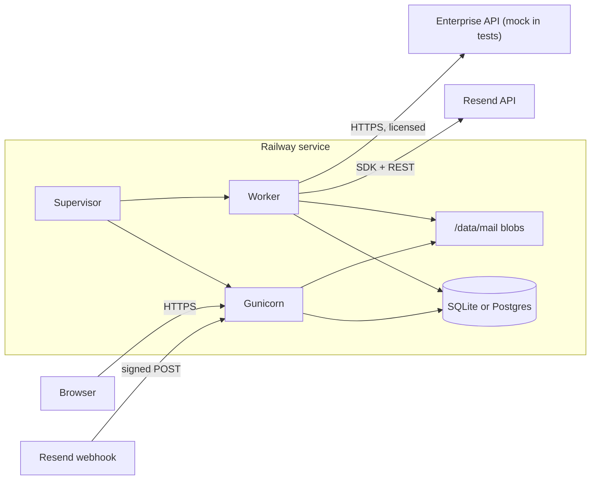

# Mailstead - Implementation Plan and Progress

Self-hosted Resend-backed email portal for 10-50 users, packaged as a one-service, one-volume Railway template. Source spec: [Project_Prompt.md](Project_Prompt.md).

Status: **M1 complete.** M2–M5 in progress per milestones below. Progress section at the bottom is updated at each milestone handoff.

---

## 1. Provider verification (done 2026-10-10)

Facts below were read from official docs / SDK source on 2026-10-10. Anything marked UNVERIFIED must be confirmed against a live account during the named milestone; code must not assume it.

### Resend

- **Python SDK** `resend` 2.49.1 (requests-based, sync). Covers: `Emails.send` (with `idempotency_key` option), `Emails.Receiving.get/list`, `Emails.Receiving.Attachments.get/list`, `Webhooks.create/list/get/update/remove/verify`, `Domains.get/list`, and **`Usage.get`** (typed `Usage`, `EmailsDailyUsage`, `EmailsMonthlyUsage`, `RateLimitUsage`, ...). Response headers are injected as `http_headers` into dict responses. Default HTTP timeout 30 s (we pass a custom client with lower timeouts). Credentials are a module global (`resend.api_key`), fine for our single worker; wrapped in one `resend_client.py` module.
  - REST fallback still planned for `GET /usage` only if the SDK model rejects new fields (thin `requests` call, same parser).
- **GET /usage** - requires a **Full access** API key (a sending-only key returns `401 restricted_api_key`). Schema:
  - `emails.daily` / `emails.monthly`: `{used, limit, sent, received, resets_at}`. `daily.limit` is `null` once the team has a paid sending subscription. `monthly.limit` is always a number.
  - `contacts`, `segments`, `broadcasts`, `domains`: `{used, limit}` (null limit = uncapped where documented).
  - `ai_credits`: `{used, limit, next_increase_at}`; `automation_runs`: `{used, limit, resets_at}`.
  - `rate_limit`: `{limit, duration}` e.g. `{1000, "1000ms"}`.
  - **No plan / subscription name field.** Confirmed: admin-set label with source "admin-entered" is required.
  - Doc inconsistency: usage page calls daily a "rolling 24-hour" window; rate-limit page says UTC calendar day resetting at midnight UTC. We trust `resets_at` from the response and never compute resets ourselves.
  - Counters are team-wide and include sent + received; label them "Resend account (all apps)".
- **Rate limits** - default 10 req/s per team across all keys (usage example shows 1000/1000ms; use the returned value). Headers `ratelimit-limit/remaining/reset`, `retry-after`. 429 types: `rate_limit_exceeded`, `daily_quota_exceeded`, `monthly_quota_exceeded`. Quota headers `x-resend-daily-quota` (free only), `x-resend-monthly-quota`.
- **Quota reached vs blocked** - 429 `*_quota_exceeded` is the only authoritative "blocked" signal. Reached allowance with paid overage may keep sending; we only mark "provider blocking" on actual 429 quota errors.
- **Receiving**
  - `email.received` webhook carries metadata only (`email_id`, `from` bare address, `to`, `cc`, `bcc`, `received_for`, `message_id`, `subject`, attachment metadata). No body, headers or bytes.
  - `GET /emails/receiving/{id}` returns `html`, `text`, `headers`, `to/cc/bcc/reply_to`, `received_for` (from `for` clause of `Received` headers), `authentication {spf,dkim,dmarc}` (computed by receiving server, unforgeable; `null` for older mail), `message_id`, `attachments[]` (with `size`, `content_id`), and **`raw.download_url` + `raw.expires_at`** (signed CloudFront URL to full original MIME). `html_format=cid` keeps cid references.
  - `GET /emails/receiving/{id}/attachments/{att_id}` returns signed `download_url` + `expires_at`.
  - `GET /emails/receiving` list: cursor pagination (`limit` 1-100, `after`/`before`, `has_more`); without `limit` returns everything - always pass `limit`.
  - `403 email_above_quota`: content of mail received while the account was above quota **cannot be retrieved**. Must be surfaced as a metadata-only "unretrievable" message, never dropped silently.
  - Retention period of received mail on Resend: UNVERIFIED (not stated on the pages read). Initial import takes whatever `list` returns.
  - Inbound size limit on Resend side: UNVERIFIED.
  - BCC semantics: webhook/API expose `bcc` and `received_for`. Whether `received_for` reliably identifies the local BCC recipient: UNVERIFIED - test in M2 with a real BCC send; routing falls back to `to`+`cc`+`received_for` intersected with local addresses.
- **Webhooks** - Svix-style signing: headers `svix-id`, `svix-timestamp`, `svix-signature`; SDK `Webhooks.verify` does HMAC-SHA256 over `{id}.{timestamp}.{raw_body}` with 5-minute tolerance. Must use the **raw** body. Create returns `{id, signing_secret}`; list/get also return the secret, which lets registration be idempotent (list, match endpoint, else create). Retry schedule: immediately, 5 s, 5 min, 30 min, 2 h, 5 h, 10 h, 10 h; endpoint is auto-disabled after persistent failures, so periodic reconciliation is mandatory.
- **Sending** - `POST /emails`: `to` max 50, `cc`, `bcc`, `reply_to`, `headers` (custom), `attachments` (max **40 MB per email after base64**, i.e. about 29 MB raw), `tags` (ASCII name/value, used to tag our outbound id).
  - Idempotency: `Idempotency-Key` header, 1-256 chars, retained **24 h**. 409 `invalid_idempotent_request` = same key with different payload (so we persist the exact payload and replay it byte-identical); 409 `concurrent_idempotent_requests` = retry later.
  - Whether a custom `Message-ID` header is honored: UNVERIFIED. Plan: send our generated Message-ID in `headers`; in M2 check the delivered copy. If overridden, record the provider's Message-ID (from the sent-email retrieve/list endpoint) for threading.
- **Domains** - `GET /domains/{id}` returns `status` and `capabilities: {sending, receiving}` ("enabled"/"disabled"). Used to verify sending separately from receiving for `MAIL_DOMAIN` and extra domains.
- Errors worth classifying: `restricted_api_key` (401), `validation_error` for unverified domain (403), `rate_limit_exceeded`/quota (429), `application_error` (500), `service_unavailable` (503).

### Railway

- **Config as Code is deprecated.** `railway.json/toml` is no longer used for services in projects created after 2026-08-28 and stops being read entirely on 2026-12-01. Every template deploy creates a new project, so a `railway.json` in the repo would be **ignored** for deployers. Consequences:
  - Template settings (Dockerfile build, start command, healthcheck path, volume at `/data`, variables) are set in the **template composer**, documented step by step in `docs/railway-template.md`.
  - Optional `.railway/railway.ts` (Infrastructure as Code, GA) for our own project; not required for deployers. Not applied to live projects by us.
- **Volumes** - one volume per service; no replicas with volumes; **deploys with a volume have brief downtime** (no overlap). Default size: Free/Trial 0.5 GB, Hobby 5 GB, Pro 50 GB; live resize up (no downsize). About 2-3 % used by filesystem metadata at creation. Non-root images need `RAILWAY_RUN_UID=0` (or chown at start). `RAILWAY_VOLUME_MOUNT_PATH` and `RAILWAY_VOLUME_NAME` are provided.
  - Whether `statvfs("/data")` reports the provisioned size: UNVERIFIED (docs silent). Plan: read statvfs, confirm `/data` is a distinct mount via `/proc/self/mountinfo`, show the value as "measured", and support `DATA_VOLUME_CAPACITY_BYTES` labelled "configured". Verify on a real deploy before claiming.
- **Pre-deploy command runs in a separate container without the volume.** So migrations (SQLite on `/data`) must run in the **start command**, not pre-deploy.
- **Shutdown** - SIGTERM, then SIGKILL after `RAILWAY_DEPLOYMENT_DRAINING_SECONDS` (default **0**). Template sets it to 30.
- **Template variables** - `${{secret(len, alphabet)}}` and `randomInt()` generate values once at deploy; `RAILWAY_PUBLIC_DOMAIN` gives the public domain. Restart policy `ON_FAILURE`/`ALWAYS`.

### Libraries (current as of 2026-10-10)

Django **5.2.18** (LTS; 6.1 exists but spec pins 5.2), gunicorn 26.x, whitenoise 6.12, django-htmx 1.29, nh3 0.3.x (HTML sanitizer), dj-database-url 3.1, psycopg[binary] 3.3, django-axes 8.3 (login lockout), PyJWT 2.15 + cryptography (Ed25519 entitlement verification), resend 2.49. Python 3.12 slim image.

---

## 2. Key decisions

- **Single container, two processes, one supervisor.** `python -m mailstead.run` runs migrations, first-run bootstrap, then starts gunicorn (1 worker, gthread, 4 threads) and one `manage.py worker` process. It forwards SIGTERM, waits up to 25 s, and exits non-zero if either child dies so Railway restarts the container. No supervisord, no Redis or Celery.
- **Custom durable job queue (small module, not a framework).** `jobs` app: `Job(kind, dedupe_key UNIQUE, payload JSON, state, attempts, max_attempts, run_after, lease_owner, lease_until, last_error_redacted)`. Atomic claim via conditional `UPDATE ... WHERE state='queued' AND run_after<=now` (portable SQLite/Postgres). Expired leases are reclaimed on restart. Exponential backoff with jitter, bounded thread pool (default 2), dead jobs visible in admin with retry action. Periodic tasks: `Schedule` rows enqueue with time-bucketed dedupe keys. Chosen over django-q2/huey/procrastinate because Procrastinate is Postgres-only, Huey's SQLite storage doesn't share our DB, and the spec prefers focused modules.
- **Database** - SQLite at `/data/db/mailstead.sqlite3`, WAL, `busy_timeout`, Django 5.2 `transaction_mode="IMMEDIATE"`. Postgres via `DATABASE_URL` (dj-database-url). Same migrations; CI runs the suite on both.
- **Cache** - Django `DatabaseCache` (for rate limits / throttles); no Redis.
- **Blob store** - `/data/mail/blobs/<sha256[:2]>/<sha256[2:4]>/<sha256>`. Content-addressed, so physical dedupe is free; writes go tmp, fsync, rename. Logical charge is per mailbox per stored item (MIME original only; bodies and attachments are parsed from the MIME on demand, with a small derived-text cache counted against the mailbox). This avoids double-storing attachments.
- **Inbound routing** - local recipients = (`to` + `cc` + `received_for` + `bcc`) intersected with active addresses and aliases. Unknown recipients go to a bounded admin "unrouted" quarantine. Each recipient mailbox gets its own `MessageCopy` row sharing one blob.
- **BCC** - stored only on the sender's Sent copy. Never rendered to other recipients, never in exported MIME of non-senders. Reply-all excludes BCC and the user's own addresses, and dedupes case-insensitively.
- **HTML safety** - nh3 allowlist sanitization, rendered in `<iframe sandbox>` (no scripts, no same-origin) served with a strict CSP. Remote images are blocked by default and rewritten to placeholders with a per-message "load images" toggle. `cid:` parts are served via an authorized attachment endpoint.
- **Secrets at rest** - webhook signing secret and enterprise service credentials are stored encrypted with Fernet keyed from `APP_ENCRYPTION_KEY` (template-generated). Routine logs redact tokens, addresses and content.
- **Entitlements** - vendor returns an Ed25519-signed JWT (`iss`, `aud=installation_id`, `exp`, `nbf`, `entitlements_version`, `capabilities`, `limits`, `grace_until`). The client pins the vendor public key(s) by config. All paid calls are still authorized server-side by the vendor per request.

---

## 3. Architecture

Django apps (few, focused):

- `core` - settings, supervisor (`run.py`), health/readiness, bootstrap, logging redaction.
- `accounts` - User (login identity), `Mailbox` (address, quota, state), `Alias`, recovery email, admin.
- `jobs` - queue, worker command, schedules, admin.
- `mail` - messages, folders, blobs, compose/send, inbound pipeline, search, views/templates (HTMX).
- `storage` - accounting, reservations, capacity, overflow, reconciliation, ops dashboard.
- `provider` - Resend client wrapper, rate limiter, webhook registration, usage snapshots, alerts.
- `enterprise` - license client, entitlement cache, spam adapter interface, feedback. `mock_vendor/` is a separate tiny Django-free WSGI app (stdlib `wsgiref` + PyJWT) used for tests and demo only.

---

## 4. Milestones

Each milestone ends with: tests green on SQLite (and Postgres where available), a progress update in this file, and a short handoff note.

### M1 - Foundation, deployment skeleton, users, admin, bootstrap

- Project layout, `pyproject.toml` with pinned deps, `Dockerfile` (python:3.12-slim, non-root user plus chown of `/data` at start, or document `RAILWAY_RUN_UID=0`), `.env.example`, `docker-compose.yml` for local dev (optional Postgres profile).
- Settings from env: `RESEND_API_KEY`, `MAIL_DOMAIN`, `ADMIN_RECOVERY_EMAIL` (required); `SECRET_KEY`, `APP_ENCRYPTION_KEY`, `BOOTSTRAP_TOKEN` (template `secret()`); `PUBLIC_URL` defaulting to `https://$RAILWAY_PUBLIC_DOMAIN`; optional `DATABASE_URL` and the storage/usage/enterprise knobs. Secure cookies, HSTS, CSRF trusted origin from public URL, `SECURE_PROXY_SSL_HEADER`.
- Supervisor `mailstead.run`: ensure `/data/{db,mail,tmp}`, `migrate`, start gunicorn plus a worker stub, signal handling, graceful drain.
- `/healthz` (liveness, no DB) and `/readyz` (DB reachable, volume writable, migrations applied, worker heartbeat fresh). No mailbox data in output.
- Accounts: custom `User` (username login), `Mailbox` (1:1 user, address unique, quota, over-quota flag), `Alias`, `recovery_email` separate from mailbox address. Public registration disabled.
- Bootstrap: on first start, if no superuser exists, create a `BootstrapState` holding a hash of the template `BOOTSTRAP_TOKEN` (or a generated token written once to `/data/bootstrap-token` with 0600 permissions if unset; never logged). `/setup/<token>` lets the admin set username/password once, then marks it consumed. Redeploys never reset it.
- Password reset via Django machinery, sent through Resend to the **recovery email** (works without portal mailbox access). Session invalidation on password change (`update_session_auth_hash` for self and a session flush for others). django-axes login lockout. DatabaseCache-based throttle on reset requests.
- Admin: users, mailboxes, aliases, quotas, disable user, reset password, bootstrap status.
- Tests: bootstrap one-time/consumed/redeploy, no credential in logs, reset tokens expire, reset goes to recovery email, sessions invalidated, rate limits, registration disabled, health/readiness, SQLite and Postgres settings switch.

### M2 - Durable sending/receiving, local retention, mailbox UI

- `jobs` worker complete: lease claim, backoff, max attempts, dead-letter, schedules, restart recovery.
- `provider/resend_client.py`: one place for API key, timeouts (connect 5 s / read 30 s), error classification, and a process-wide token-bucket limiter seeded from `usage.rate_limit` (default 10/s, halved for headroom), honoring `retry-after`.
- Webhook endpoint `/hooks/resend`: request size cap, verify signature on raw body via `resend.Webhooks.verify`, insert `WebhookEvent(svix_id UNIQUE)` plus a job (`dedupe_key=inbound:<email_id>` or `outbound-status:<email_id>:<type>`) in one transaction, then 200. Invalid gives 400. Duplicates give 200 with no new job.
- Inbound job: retrieve email, stream `raw.download_url` into `/data/tmp` with size cap (`MAX_MESSAGE_BYTES`, default 30 MB) and timeout, re-fetching metadata if the URL expired. Storage reservation is hooked here (stubbed in M2, enforced in M3). Write blob, parse with stdlib `email` (policy.default), cross-check attachment sizes with API metadata, create `Message` plus `MessageCopy` per local recipient, store `authentication` results, mark `archived=True` only after fsync + commit. Handle `email_above_quota` as a metadata-only unretrievable record visible to admin and recipient.
- Reconcile job (every 15 min): page `GET /emails/receiving?limit=100` newest-first until hitting already-known ids; enqueue missing. Initial import command and admin action: full walk, rate-limited, resumable via stored cursor.
- Webhook auto-registration (admin button plus startup job once `PUBLIC_URL` is set): list webhooks, match endpoint, else create with `email.received`, `email.sent`, `email.delivered`, `email.delivery_delayed`, `email.bounced`, `email.complained`, `email.failed`, `email.suppressed`. Store id plus encrypted secret. Detect a disabled endpoint and alert admin.
- Domain check: `Domains.list/get`, show sending/receiving capability per configured domain. Block sending from domains without `sending=enabled`.
- Outbound: compose (plain text), reply/reply-all/forward, attachments (bounded, counted toward 40 MB base64). Authorized From = user's mailbox or aliases only. Build Message-ID / In-Reply-To / References. Persist `OutboundMessage` with frozen payload JSON and `idempotency_key=uuid4`, store attachments as blobs, and copy to Sent (state `queued`) **before** the send job. Send job replays the identical payload with the same key. States: `queued`, `sending`, `accepted(provider_id)`, then `delivered/bounced/failed/complained/suppressed` from webhooks. Unknown outcome (timeout/5xx) is retried with the same key until `created + 23h`; after that it becomes `uncertain` and reconciles via the sent-emails list endpoint filtered by our tag. If still not found, admin decides (never auto-resend). 429 quota errors give `held_provider_quota` (mail kept, retried after `resets_at` or admin action).
- UI (Django templates + HTMX): folders Inbox/Sent/Drafts/Archive/Junk/Trash, unread state, pagination, search (sender/recipient/subject/body via `icontains` on indexed denormalized fields; Postgres uses the same query), message view with sanitized HTML iframe, remote images off, attachment download, MIME export (`.eml`), storage usage widget (placeholder values until M3). Every query is scoped by `request.user.mailbox`.
- Free-core filtering: local sender/domain block/allow rules, "Mark as junk / not junk", and use of the Resend `authentication` (spf/dkim/dmarc) results as a signal into Junk.
- Tests: signature valid/invalid/stale/raw-body mutation, webhook dedupe, job crash mid-download then restart and resume, expired download URL refresh, oversize message, `email_above_quota`, alias and BCC routing, unknown recipient quarantine, cross-mailbox access to message/attachment/search/export is 404, BCC never leaked, reply-all dedupe and Reply-To respected, outbound idempotent replay, 409 handling, uncertain-after-window path, HTML sanitizer and remote image blocking, path traversal on blob/attachment ids.

### M3 - Storage enforcement and operations dashboard

- `storage` app:
  - `StorageLedger` singleton row: `email_consumed_bytes`, `reserved_bytes`, `overflow_bytes`, `last_reconciled_at`.
  - Per mailbox: `charged_bytes`, `quota_bytes`, `state` (ok/warn80/warn90/full/over_quota).
  - `Reservation(id, mailbox, bytes, purpose, expires_at, state)`.
- **Reserve-then-write**: in one transaction (IMMEDIATE on SQLite, `select_for_update` on the ledger and mailbox rows on Postgres) check mailbox quota, global budget, and physical effective capacity, then insert a reservation. Write blob. Commit converts the reservation to charge. Failure or crash releases it, and expired reservations are swept by a job.
- Capacity model (all shown with source labels "measured" vs "configured"):
  - Physical: statvfs on `/data` gives total, used, usable free (`f_bavail`). Optional `DATA_VOLUME_CAPACITY_BYTES` override.
  - `reserve = max(DISK_RESERVE_BYTES, db_size*2 + tmp_cap)`.
  - `effective_email_capacity = min(EMAIL_BUDGET - consumed - reserved - overflow, usable_free - reserve)`.
  - Allocation: sum of mailbox quotas vs budget. Admin form refuses allocations over budget unless an explicit "overcommit" flag is set.
- Per-mailbox: charged, quota, remaining, percent; thresholds 80/90/100 configurable. Lowering a quota below usage sets `over_quota` and never deletes. Bars, bytes remaining, last-updated.
- Full-mailbox inbound: since Resend already accepted the mail, we never reject. Store into bounded **overflow** (`OVERFLOW_BUDGET_BYTES`, per-message cap, `OVERFLOW_TTL_DAYS`) flagged and visible to admin and user. When overflow is also exhausted, keep only the metadata record ("not archived - storage full") with a retryable job, and the mail remains retrievable from Resend while Resend retains it. On space freed, a job drains overflow into mailboxes. Expiry policy: at TTL, overflow items are released to metadata-only with admin notice (never silent). Quarantine and unrouted stores have their own byte caps.
- Purge and Trash emptying decrement charges. Blob GC deletes unreferenced blobs. Orphan sweep removes tmp files older than 1 h and blobs with no DB reference (grace period).
- Reconciliation job (nightly plus admin button): recompute charges from DB sizes, walk blob dir incrementally (cursor, time-bounded), and report drift. Page views read counters only.
- Ops dashboard (staff-only custom view): capacity panels, mailbox table, overflow, failed/dead jobs, delivery states, webhook status, worker heartbeat.
- Tests: concurrent reservations (threads plus Postgres), failed write rollback, crash leaves reservation then sweep, quota reduction gives over_quota, budget overcommit prevention, overflow bound/expiry/drain, **real disk exhaustion** using a small loopback/tmpfs mount in CI (skipped with a clear marker if unavailable), reconciliation drift repair, users see only their own usage.

### M4 - Resend usage, subscription labelling, alerts

- `UsageSnapshot(fetched_at, raw JSON, parsed fields, ok)` keeping the last success plus last error. Poll job every `USAGE_REFRESH_MINUTES` (default 30, min 5) plus manual refresh (rate-limited). On failure keep the stale snapshot with a warning badge and age.
- Parser: missing field gives "unknown" (never 0). `limit: null` gives "uncapped (per Resend docs)" for documented fields only, otherwise "unknown". Display daily/monthly used, sent, received, limit, remaining, `resets_at`, and rate limit. Secondary panel for contacts, segments, broadcasts, domains, ai_credits, automation_runs.
- Labels: "Resend account totals (all applications on this API key's team)" vs "Portal-only counts" (from our own Message tables, separately labelled).
- Subscription: show "Plan: not provided by Resend API" plus optional admin-entered label marked "admin-entered, not verified". Never inferred from limits.
- Alerts: thresholds (default 80/90/100 %) per quota and period. `UsageAlert(quota, period_key=resets_at, threshold)` unique, so each fires once per period and resets when `resets_at` changes. Delivery: in-app notice always, email to admins via Resend when possible. If sending fails (including quota), the in-app notice persists.
- Distinguish states: "allowance reached" (from usage) vs "provider blocking sends" (observed 429 quota error in last N minutes). Optional `LOCAL_SEND_BUDGET_MONTHLY`/`DAILY`: when exceeded, outbound jobs are held (not failed) with admin override.
- Restricted (sending-only) key: usage panel shows "requires Full access API key" instead of failing silently.
- Tests: schema parsing with nulls/missing/extra fields, stale snapshot retention, refresh error state, alert dedupe and reset across periods, 429 quota gives held mail (not lost), overage (reached but sending succeeds), local budget hold, plan-label fallback and source labelling, restricted key message.

### M5 - Enterprise client, mock vendor, final verification, template docs

- **Versioned contract** `docs/enterprise-api-v1.md` (+ JSON schemas in `enterprise/contract/`):
  - `POST /v1/activate {license_key, installation_id, domains, client_version}` returns `{service_credential, entitlement_token}`.
  - `POST /v1/entitlements/refresh` (Bearer service credential) returns `{entitlement_token}`.
  - `POST /v1/spam/classify` (Bearer) with `{message_id, mime_b64 | mime_sha256+mime_b64, envelope{from,to}, auth_results}` returns `{verdict: ham|spam|unsure, score, reasons[], service, engine_version, model_version}`.
  - `POST /v1/spam/feedback {message_id, label}`.
  - Errors: 401 invalid credential, 402 not entitled, 403 scope (domain/customer), 429 limits, 503 unavailable.
- Client (`enterprise/`):
  - `InstallationIdentity` (UUID, persisted once). `License` (encrypted key and credential). `EntitlementCache(token, verified_claims, valid_until, grace_until, last_refresh, last_error)`.
  - Ed25519 verify via PyJWT with pinned public keys (`ENTERPRISE_PUBLIC_KEYS`, built-in default for production vendor), checking `aud=installation_id` and domain scope.
  - States are kept distinct: **licensed** (valid entitlement), **configured** (admin enabled the feature and accepted the data-flow notice), **healthy** (last vendor call OK).
  - Capability checks read the cache at request time, so activation or upgrade takes effect immediately without restart.
  - Refresh job every 6 h. Grace window bounded (e.g. 72 h) on vendor outage. Expiry/revocation disables paid features and leaves core untouched.
- Spam adapter interface `SpamClassifier.classify(message) -> Verdict` with implementations `LocalRulesClassifier` (free) and `HostedClassifier` (vendor). Pipeline: message persisted, then a `scan` job (pending with retries), then a verdict stored (`ScanResult`, kept forever), then a separate **policy** step (thresholds move to Junk). Fallback policy when the service is unavailable: deliver to Inbox, mark "unscanned", rescan on recovery (configurable). Feedback from Junk/Not-junk actions stored locally and sent to the vendor only if opted in.
- Data-flow notice on the Enterprise page: hosted filtering sends message content (MIME) and envelope to the vendor. Never sends the Resend API key, passwords, other users' data or account info. Enforced by a payload builder with an allowlist plus a test.
- Enterprise admin page: license status, capabilities, expiry, grace, service health, activate/refresh/deactivate.
- `mock_vendor/`: runnable `python -m mock_vendor` (stdlib HTTP + PyJWT), test keypair generated at startup, fixtures for licenses (valid, expired, revoked, wrong-domain, upgraded). Classifier is deliberately trivial (keyword markers like `MOCK-SPAM`) and every response carries `service: "mock-vendor (NOT a real spam filter)"`.
- Final verification:
  - Full test suite on SQLite plus Postgres (Postgres via docker in CI / local; state if not run).
  - End-to-end smoke: docker build, run with fake Resend (local stub server), bootstrap, create user, simulated inbound webhook, read, reply, outbound accepted.
  - Memory: RSS of supervisor + gunicorn + worker measured idle and under a small load script (`ps`/`/proc/*/status`), reported as measured locally and estimated for Railway.
- Docs:
  - `README.md` (quick start).
  - `docs/deploy-railway.md` and `docs/railway-template.md`: composer steps, Dockerfile build, start command, healthcheck `/readyz`, volume `/data`, variables with `${{secret()}}` for `SECRET_KEY`/`APP_ENCRYPTION_KEY`/`BOOTSTRAP_TOKEN`, `PUBLIC_URL=https://${{RAILWAY_PUBLIC_DOMAIN}}`, `RAILWAY_DEPLOYMENT_DRAINING_SECONDS=30`. Explicit note that **no template has been published**.
  - `docs/operations.md`: backups/restore (Railway volume backups + `manage.py export`), SQLite to Postgres migration (`dumpdata`/`loaddata` procedure, tested if possible), upgrades, volume resizing, provider permissions (Full access key), DNS (MX/SPF/DKIM per Resend), quota behaviour, overflow, outages.
  - `docs/enterprise.md`: core vs vendor responsibilities, data flow, and what remains for a paid launch (billing, license issuance, production classifier, key management/rotation, SLA, DPA/privacy terms, abuse handling, vendor-side rate limiting and scope enforcement, monitoring).

---

## 5. Assumptions

- Python 3.12; Django 5.2.18 LTS pinned `>=5.2.18,<5.3`.
- One mailbox per user; aliases map to a mailbox; no shared mailboxes initially.
- `MAIL_DOMAIN=mail.baytfoods.ca` is already a receiving domain; sending capability is checked, not assumed.
- Default limits: `MAX_MESSAGE_BYTES=30MB`, outbound attachments 25 MB raw total, `EMAIL_BUDGET` defaults to 70 % of measured volume size if unset (shown as derived), `DISK_RESERVE_BYTES=256MB`, `OVERFLOW_BUDGET_BYTES=5 %` of budget, `OVERFLOW_TTL_DAYS=14`, worker concurrency 2.
- No live account, DNS, webhook, or Railway changes are made during implementation. Webhook registration runs only on the deployed instance when an admin triggers it or `PUBLIC_URL` is set.
- Tests use mocked Resend (`responses`-style stubs at the requests layer) and the mock vendor; live-API behaviour marked UNVERIFIED above stays flagged until checked.

## 6. Open provider questions (to verify on a live account)

1. Does `statvfs(/data)` on Railway report the provisioned volume size? (M3 deploy check)
2. Is a custom `Message-ID` header preserved by Resend on send? (M2)
3. Does `received_for` reliably identify BCC'd local recipients? (M2)
4. Received-mail retention period and inbound size limit on Resend. (M2, ask Resend support if undocumented)
5. Which daily-window semantics apply to `emails.daily` (rolling vs UTC)? We rely on `resets_at` either way.

---

## 7. Progress

- [x] Spec read; Resend and Railway docs verified (2026-10-10)
- [x] Five-milestone plan written (this file)
- [x] M1 Foundation, deployment skeleton, users, admin, bootstrap (2026-10-10)
- [ ] M2 Durable sending/receiving, retention, mailbox UI
- [ ] M3 Storage enforcement and ops dashboard
- [ ] M4 Resend usage, subscription labelling, alerts
- [ ] M5 Enterprise client/mock, final verification, template docs

Completed checks:
- **M1 (2026-10-10):** `pytest` — 10 passed, 1 skipped (Postgres marker; run with `DATABASE_URL=postgres://...`). Covers bootstrap one-time/consumed/redeploy, health/readiness, password reset to recovery email, rate limit, session invalidation, registration disabled, disabled mailbox login. Handoff: run `python -m mailstead.run` or `docker compose up`; open `/setup/<BOOTSTRAP_TOKEN>` once; worker heartbeat required for `/readyz` unless `SKIP_WORKER_HEARTBEAT_CHECK=1`.
